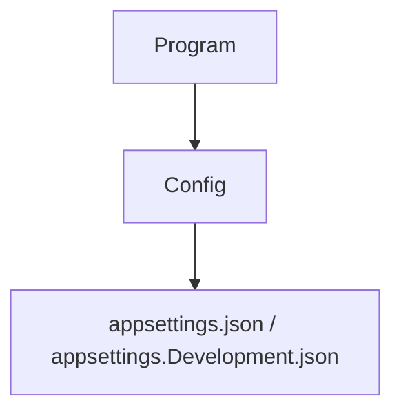

# MCPhappey.WebApi

Web API host for MCPhappey, exposing dynamic MCP servers and tools via HTTP endpoints.

## Architecture



## Key Features
- Hosts and exposes MCP servers over HTTP
- Integrates all MCPhappey packages
- Entry point for web-based access to MCP functionality

## Usage

```sh
dotnet run --project src/MCPhappey.WebApi
```

## Dependencies
- MCPhappey.Core
- MCPhappey.Decoders
- MCPhappey.Servers.SQL
- MCPhappey.Servers.JSON
- MCPhappey.Tools
- MCPhappey.Common
- MCPhappey.Auth

## Dual-mode agents and Decisions

OpenAI Agents, OpenAI Decisions, and Anthropic Agents use the same server definitions in both hosting modes:

- **Header mode:** callers supply an OpenAI bearer API key or Anthropic x-api-key, as declared in the registry. Operator provider keys are not used. File inputs must be public HTTPS URLs; protected SharePoint/OneDrive files and folder discovery require delegated authentication. Public downloads preserve MIME types and filenames, have a 32 MiB limit, and validate redirects and network destinations. Signed/one-time public URLs retain their query strings.
- **Entra mode:** when OAuth is configured, these servers require a validated Microsoft Entra identity and retain operator-configured provider credentials and existing authenticated SharePoint/Graph downloads. A direct provider key cannot replace Entra authentication, and provider credentials supplied by the caller are not used. Authorization failures do not cause a downgrade to header mode.
- Existing tool names, arguments, structured results, resource URIs, confirmations, and Decisions folder/progress behavior are retained. No new storage uploads are performed. Agent resource reads use the same credential boundary as agent tools, before generic operator scrapers.

The sample registers this support automatically through [WithCompletion](../../Abstractions/MCPhappey.Tools/Extensions/AspNetCoreExtensions.cs:23) and [AddOpenAIDecisions](../../Abstractions/MCPhappey.Tools/OpenAI/Decisions/ServiceCollectionExtensions.cs:10). Custom hosts exposing these servers must register [AddDualModeAgentAccess](../../Abstractions/MCPhappey.Tools/AgentProviderAccessExtensions.cs:9) as well as the normal Core services and server-access middleware. Delegated Decisions access still requires its existing operator domain-header registration; header-mode Decisions access does not require an operator key.
